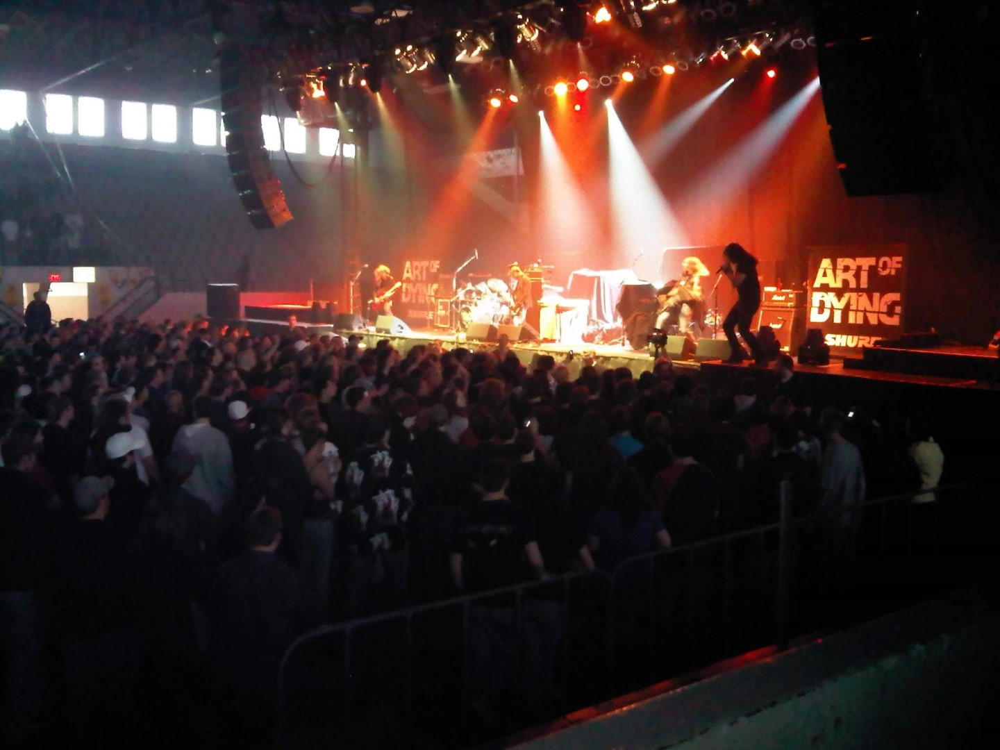
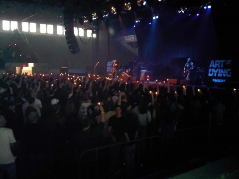
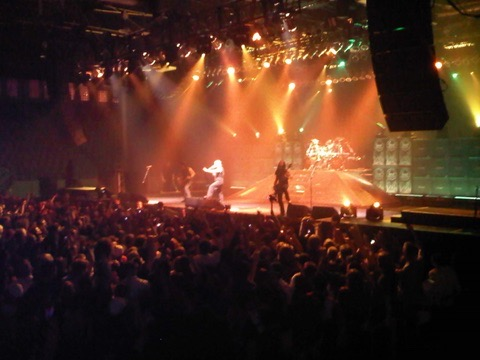
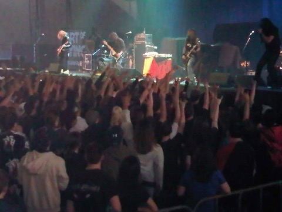
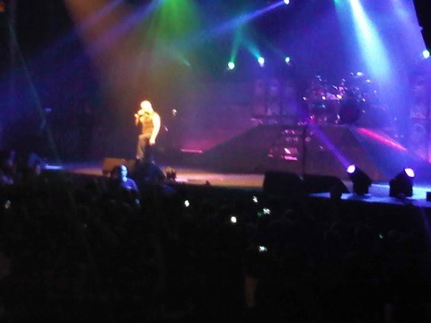
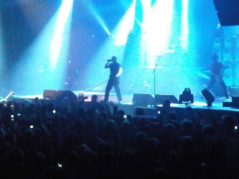
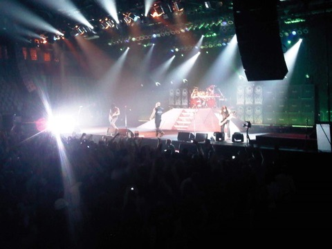
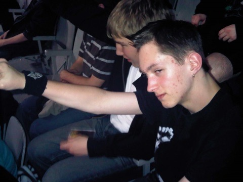
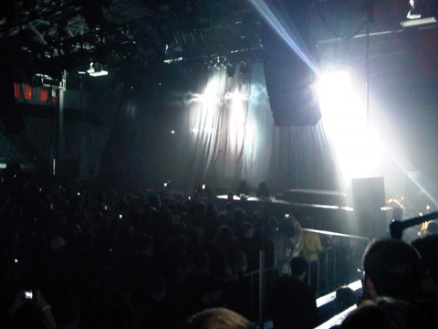

# Concert at the Halifax Forum

My son Adam, his friend Ben and I had a great time. It was a small, but very engaged crowd.

We enjoyed all four acts --- time well spent and worth every penny.

<ul>
	<li>Art of Dying (<a href="http://www.artofdyingmusic.com/">http://www.artofdyingmusic.com</a>)</li>
	<li>Skindred (<a href="http://www.myspace.com/skindred">http://www.myspace.com/skindred</a>)</li>
	<li>All That Remains (<a href="http://www.allthatremainsonline.com/">http://www.allthatremainsonline.com</a>)</li>
	<li>Disturbed (<a href="http://www.disturbed1.com/">www.disturbed1.com</a>)</li>
</ul>

