# Peggy’s Cove

My sweetheart Rhonda, our friend Johanna and I did a little local tourism today.

I've been to <a href="http://en.wikipedia.org/wiki/Peggys_Cove,_Nova_Scotia">Peggy's Cove</a> a couple of times before but today was too nice a day to pass up an outing --- cool, breezy, sunny and not crowded.

Most people have seen the lighthouse a million times on any given Nova Scotia souvenier, so no goram lighthouse, m'kay?

I'm still surprised that a decade later, people still leave flowers in remembrance of <a href="http://en.wikipedia.org/wiki/Swissair_Flight_111">Swissair 111</a>.

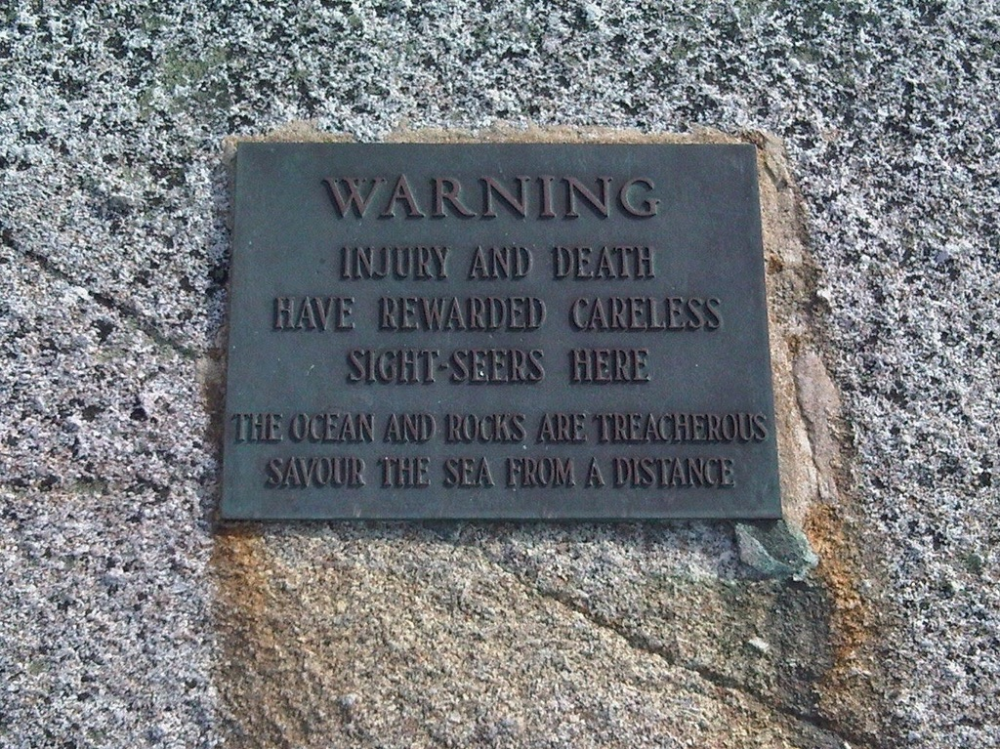
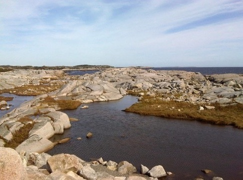
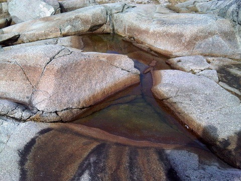
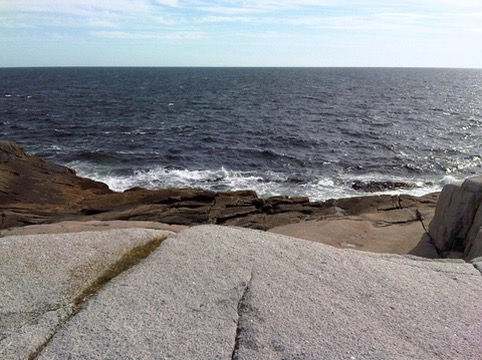
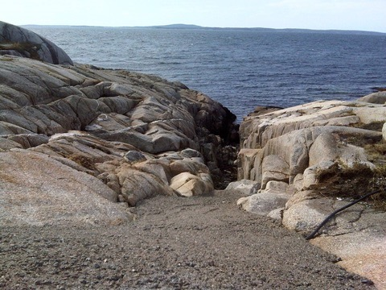
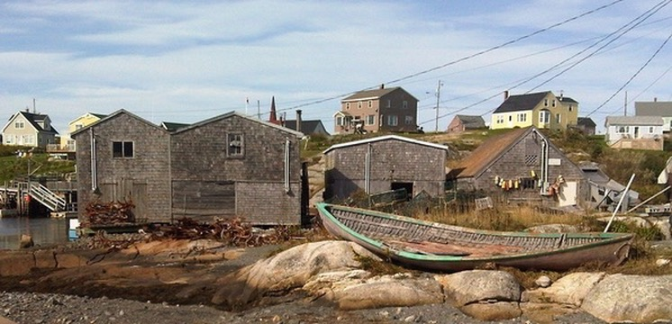
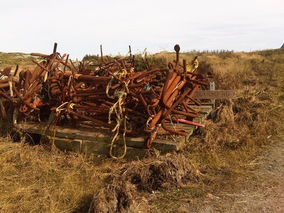
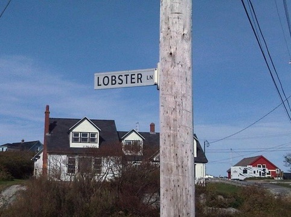
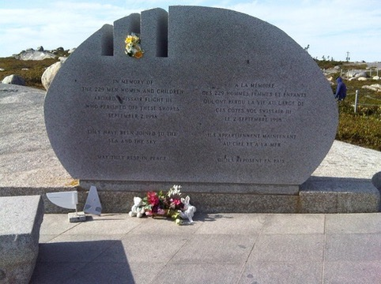
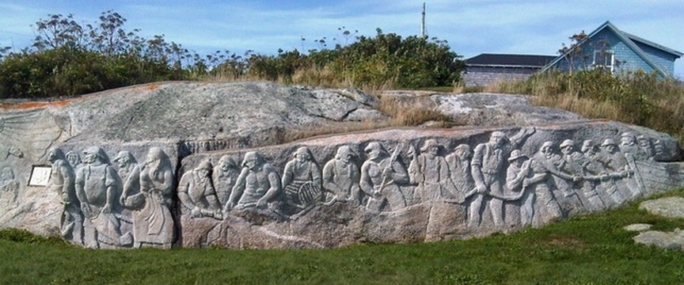
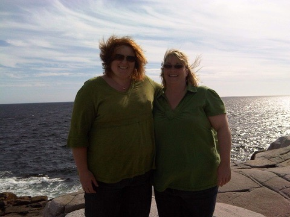
