# Our Funny Farm

We moved to Milford, Nova Scotia on March 2nd, 2020– two weeks before the arse came out of the world. It was a weird first year being locked down, no house warming, and we still haven’t met all our neighbours. It felt like we were house sitting for a very long time.

Rhonda and I have always loved animals and over the last almost three years, we kinda accidentally started a hobby farm, called Our Funny Farm.

Pekin ducks were first. We house them in an exclusive gated community called Duckington Heights. The current flock of five are Mickey, Donald, Peach, Quack-quack, and Bluebear. Their eggs are delicious— when the freeloaders lay them. Whatever you do, do not Google duck sexuality. You have been warned.

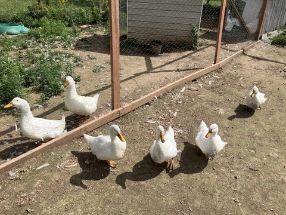
*The residents of Duckington Heights*

Rabbits were next. We have some California-New Zealand hybrids and some Cinnamons. They live in pallet-built hutches under a huge horse chestnut tree called Bunnytown. We breed them for meat for sale. Yes, the babies are cute little house hippos. There’s a fair market for rabbit and we’ve done well so far. The breeding stock are our pets: Penny, Lenny, Rocket, Flower and the OG buck Thumper the Humper.

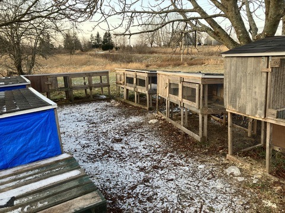
*Bunnytown*

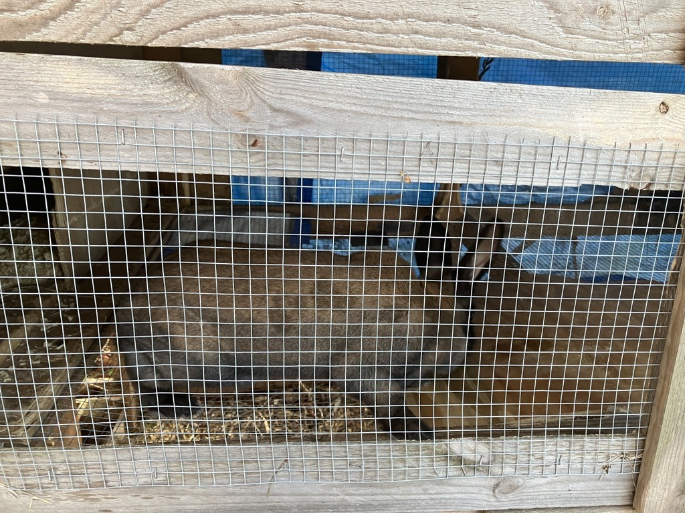
*Rocket loves him some scritches*

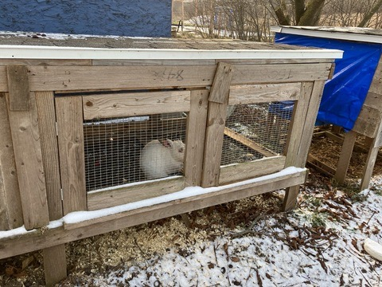
*Penny is a good mom*

The goats of Kid Row are straight-up pets. And we love them: Peanut (boer) and Coco (pygmy). They are a bonded pair and a lot of fun.

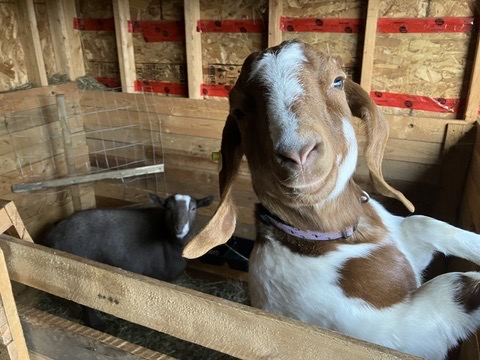
*Peanut says 'Hi' and Coco says 'Haayyyy'. Goats are the GOAT.*

We have nine layer hens in Butt Nugget Palace. Dorothy, Rose, Blanche, Sofia and Wiggles are formally named. I call the others Betty, Smoke, Paint and Barbie. Doctor Harry Weston presides as resident rooster.

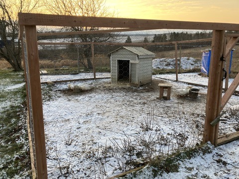
*Harry and his Ladies*

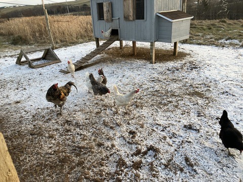
*Rose escaping to St Olaf*

We also raised three dozen meat chickens this year in two 12 week batches. They are all in the deep freeze now, nicely addressing some inflationary food security concerns of us, friends and family. They dressed at between 5-1/2 and 8-1/2 pounds each— twice to three times the size of a typical grocery store bird.

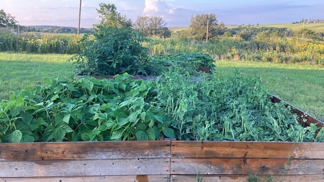
*Chicks are cute*

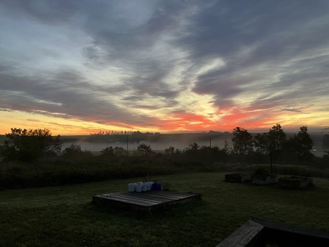
*Chickens are less cute*

One of the cool things about raising your own meat is the lessons it can teach. I feel it’s important to know where your food comes from and to approach this endeavour with gratitude and respect. For example, our grandkids all come visit and dote on all the critters, raining them with love and snacks. Catie said at one point of the meat chickens that they looked good enough to eat. Two minutes later she said they looked like they wanted to eat her. A funny moment. Big birds indeed.

Our garden boxes also produced a healthy bounty of cucumbers, tomatoes, yellow beans, and peas. The animal waste hay we put in the bottom of the boxes made for extremely health soil. We’re looking forward to another high yield next season.

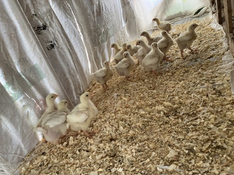
*Epic garden boxen*

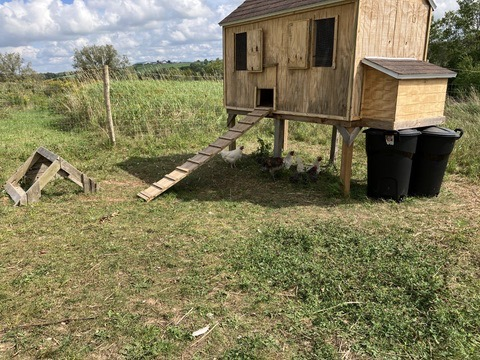
*So. Many. Cukes.*

There’s also a bunch of fruit-bearing things on the property: apples and chokecherries in particular. But we keep finding gems like a random white current bush.

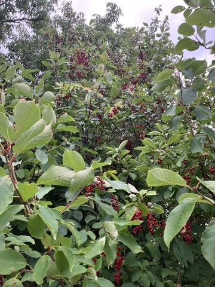
*We have a lot of chokecherries*

Next year, we’re going to raise more meat birds and expand our egg-laying capacity with a second flock. We’ll also be raising more meat rabbits for sale. Rhonda has done a great job planning all the details and tracking our progress.

#farm #homestead #goats #rabbits #ducks #chickens #garden
